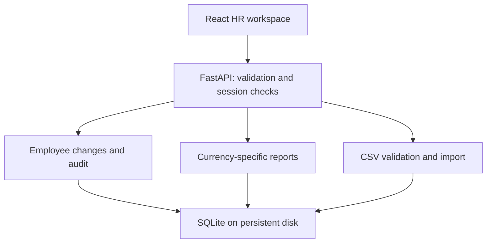

# Architecture and trade-offs

## One deployable application

The React production build is served by the same FastAPI process that handles `/api`. This gives one origin, one deployment and no cross-origin credential configuration. Vite is development/build tooling, not the production server.

## Modules and boundaries

| Module | Owns | Does not own |
| --- | --- | --- |
| `domain.py` | Valid employee input, decimal money conversion, statistics, allowlisted filters/sort | HTTP, persistent connections |
| `database.py` | Connection lifecycle, schema initialization, read/write transactions | Salary policy |
| `employees.py` | Create/update, optimistic version check, append audit event, paginated directory | Authentication |
| `reports.py` | Active-only aggregation within one explicit currency | FX conversion, payroll or fairness conclusions |
| `imports.py` | Shared CSV validation, atomic batch insert, safe CSV export | Updating existing records |
| `security.py` | Demo sessions, CSRF check, throttling, bounded request bodies | Enterprise identity provider |
| `main.py` | Routes, error translation, headers, built UI | Business rule implementation |

## Data model

`employees` has one current record per person. Employee code and normalized email are unique. Country and currency are independent: relocating an employee does not silently convert their salary. Money is a positive integer in minor units; all supported currencies have two minor-unit digits. The API exchanges decimal strings, preventing binary floating-point drift.

`audit_events` captures actor, timestamp, reason, action and complete before/after snapshots. Employee creation has no before snapshot. Salary history is retained in these snapshots. SQLite triggers reject application updates/deletes to audit events; this is **not** tamper-proof storage against a database administrator. A real identity provider is required to attribute actions to individual HR users.

`sessions` stores only hashed session identifiers, CSRF tokens and expirations. `login_attempts` stores hashed client identifiers and short-lived throttling windows. `seed_runs` prevents a restart/reseed from overwriting edits.

## A safe edit

The UI sends `expected_version`. The server takes SQLite's write lock with `BEGIN IMMEDIATE`, reads the existing record and checks that version, then updates the row and inserts the audit event in the same transaction. A competing editor gets HTTP 409. A failed audit insert rolls the salary change back. No in-memory lock is relied on.

This version retains a proposed edit in the form after conflict and asks the user to reopen the latest record. It does not automatically merge monetary edits. Requests can be retried after a 503 database-busy response. A create/import retry cannot duplicate employee codes or emails; there is no separate general-purpose request-idempotency layer.

## Reporting correctness

Reports always require one currency. Active employees only. Total = sum of base salary; mean = total/headcount; median = middle sorted salary, or mean of the two middle values. Mean/median display rounds half-up to two decimals; a group with no people has `null` statistics and zero total. Count and rows are read in the same snapshot. Frontend money formatting keeps decimal strings and uses BigInt for the whole amount.

The UI never combines INR and USD totals or silently ranks salaries across currencies. The directory's salary sort groups currency first. These reports describe base salary; they cannot establish take-home pay, total compensation, purchasing power or pay equity.

## 10,000 employees

The browser requests 25 records at a time, at most 100. SQL selects only that page. Name/email search intentionally uses literal substring matching; a full-text system is unnecessary at this size. Indexes serve stable name pagination and status/currency report filters. Reports fetch the selected currency's active records and calculate medians in Python; at the required scale this is bounded and simple. CSV import/export is bounded to 10,000 input rows / 3 MB input text; export uses memory and is intended for this dataset size.

SQLite is a practical single-service relational choice here. Its write lock serializes concurrent writers and a 3-second wait returns a retryable 503. Multi-instance horizontal scaling or sustained concurrent import traffic would justify Postgres and a migration plan. The Docker process has one Uvicorn worker; deploying multiple services against separate SQLite files would be incorrect.

## Deliberate limits

- Six configured countries/currencies and six departments demonstrate multinational data; arbitrary organization administration is not built.
- Annual gross base salary, immediate changes; no monthly/hourly normalization, compensation components, scheduled changes or retroactive corrections.
- Deactivate/reactivate instead of deleting history; no approval workflow.
- Add-only CSV migration. Updating existing employees through import would need explicit matching, conflict and approval rules.
- Deterministic reports instead of an LLM product feature. AI development tooling is used and documented; the brief's reporting interpretation remains a clarification question.
- One shared HR demo identity. Secure session handling is implemented, but this is not a claim of production HR access governance.

## Next changes, if requested

Confirm business semantics first. For monthly pay, preserve pay frequency and annualize with a documented rule. For FX, use dated rate snapshots with explicit source/base currency and keep original salary values. For multiple HR managers, integrate SSO and stable per-user actors. For an AI Q&A feature, map validated intents to existing read-only report operations; do not permit arbitrary model-generated SQL against salary records.
